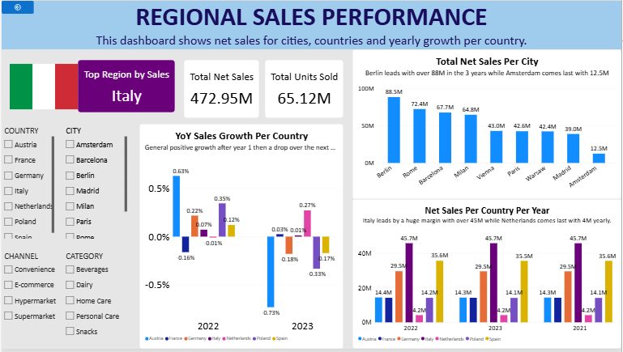

# FMCG Multi‑Country Regional Sales Dashboard (Fast Moving Consumer Goods).
## Dashboard Preview

---

## Project Overview
- This project analyzes multi‑country FMCG sales data spanning 3 years and over 1.1M rows.
- The dataset includes 15 countries, 60+ cities with latitude/longitude, product categories, sales channels, and promotion details.
- Analysis will be done for **Regional Sales Performance.**

---

## 📂 Project Structure
- `Sales_Dashboard.pbix` → Power BI dashboard file.
- `fmcg_sales.csv` → Raw dataset (from Kaggle).
- `README.md` → Documentation for this project.
- `DAX_Measures.md → Documentation for the measures applied.

---

## 📊 Dataset
- **Data source**: [Kaggle FMCG Multi-Country Sales Dataset](https://www.kaggle.com/datasets/robertocarlost/fmcg-multi-country-sales-dataset)
- **Size**: 1.1M+ rows, 33 columns  
- **Coverage**: 3 years of daily sales  
- **Regions**: 15 countries, 60+ cities with lat/lon. 

---

## 🛠 Data Modeling
### Steps Taken in Power Query
1. **Data Cleaning**
   - Promoted headers for clarity.
   - Changed column types to appropriate data types (Date, Text, Decimal, Whole Number).
   - Renamed columns for consistency (e.g., `margin_pct` → `Profit_margin_percentage`, `discount_pct` → `Discount_percentage`).

2. **Fact Table Creation**
   - Built the **Sales** fact table containing transactional measures:
     - `date`, `store_id`, `sku_id`, `units_sold`, `list_price`, `Discount_percentage`, `promo_flag`, `gross_sales`, `net_sales`,`Purchase_cost`.

3. **Dimension Tables**
   - **DateDim** → Calendar attributes for time‑based analysis.  
   - **RegionDim** → Regional identifiers for geographic analysis.
   	- Preparation of geographic attributes for regional analysis
   	- Addition of country flag image URLs for enhanced visual storytelling
   - **ProductDim** → Product attributes (`sku_ID`, `sku_name`, `category`, `subcategory`, `brand`).  
   - **SupplyChainDim** → Supply chain metrics (`SupplierID`, `stock_on_hand`, `stock_out_time`, `lead_time_days`).  
   - **ChannelDim** → Sales channel types (`ChannelID`, `Channel`).  
   - **StoreDim** → Store identifiers (`StoreID`).

4. **Surrogate Keys**
   - Added surrogate keys (Index Columns) for Product, Channel

5. **Schema Design**
   - Central **Sales** fact table linked to dimension tables:
     - `Sales[ProductID]` → `ProductDim[ProductID]`
     - `Sales[RegionID]` → `RegionDim[RegionID]`
     - `Sales[StoreID]` → `StoreDim[StoreID]`
     - `Sales[ChannelID]` → `ChannelDim[ChannelID]`
     - `Sales[SupplyChainID]` → `SupplyChainDim[Supplier_ID]`

---

## 📈 Dashboard

### Regional Sales Performance
- The Regional Sales Performance Dashboard provides an interactive view of sales performance across multiple European countries and cities.
- The dashboard is designed to help stakeholders identify top-performing regions, monitor sales trends over time, evaluate year-over-year growth, and compare city-level contributions to overall revenue.

#### Executive KPIs
- The top section provides high-level business metrics:
- Top Performing Country
- Total Net Sales
- Total Units Sold

#### City Sales Performance
- Ranks cities based on total net sales, making it easy to identify major revenue contributors and underperforming locations.

#### Country Sales Comparison
- Compares total net sales across countries for multiple years, highlighting changes in regional dominance and market trends.

#### Interactive Filters
- Users can filter the dashboard by:
- Country
- City
- Channel
- Product Category

- This enables detailed regional and product-specific analysis.

# 📈 Key Insights
- The dashboard enables users to:
	- Identify the highest-performing countries and cities
	- Track sales growth trends across regions
	- Compare annual performance across multiple markets
	- Analyze regional contributions to total sales
	- Support strategic planning and market expansion decisions

# 🔧 Tools Used
- Power BI
- Power Query
- DAX
- Data Modeling
- Data Visualization